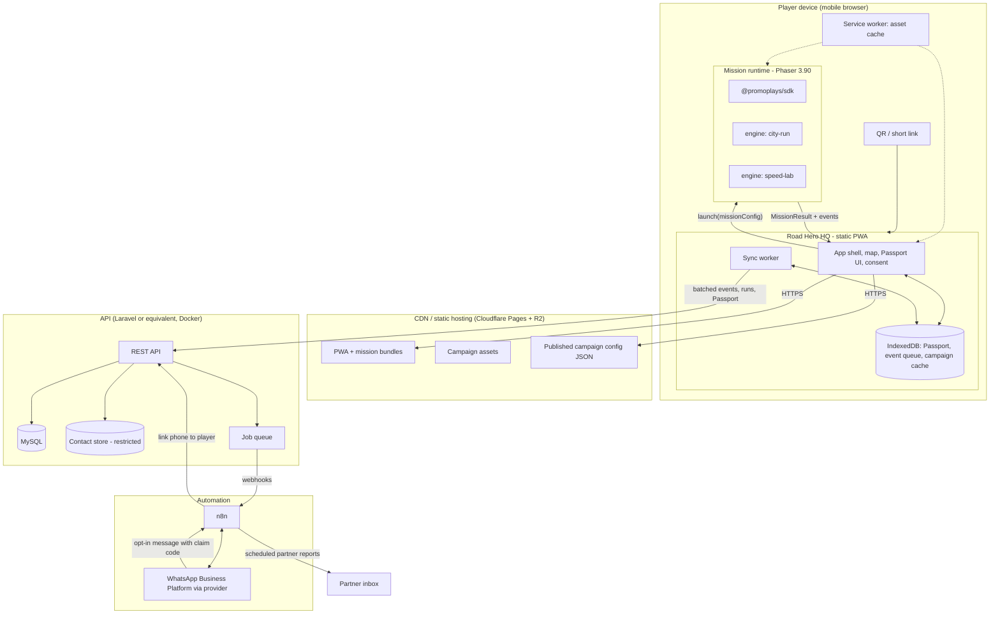
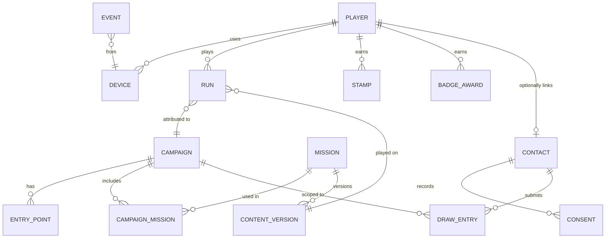
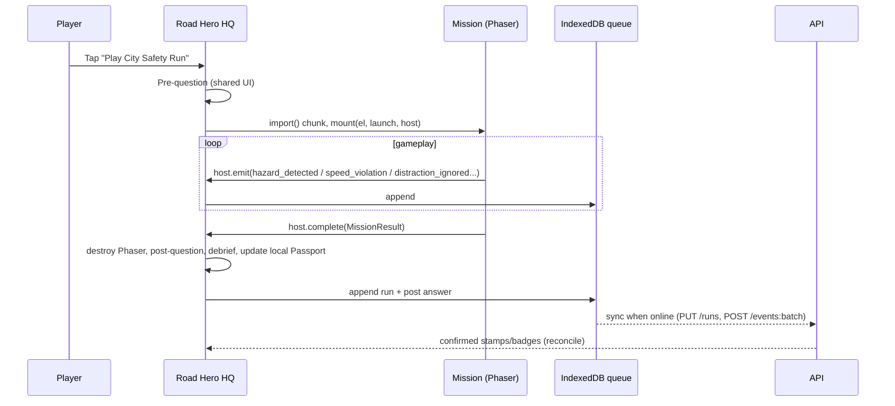

# Safe Roads World — Recommended Architecture

**Prepared for:** PromoPlays engineering leads and developers
**Date:** 11 October 2026
**Companion to:** [safe-roads-world-analysis.md](safe-roads-world-analysis.md) · [safe-roads-world-feature-matrix.md](safe-roads-world-feature-matrix.md)

Labels: **[Confirmed]** = seen in this workspace. **[Context]** = seen in `../promoplays-sdk`. **[Assumption]** = needs confirmation.

---

## 1. Starting point

| Asset | State | Role in target architecture |
|---|---|---|
| This workspace (`safe-roads-speed-mission`) | JS + Phaser 3.80 + Vite 5; 6 chained scenes; no backend; no types; no tests; not under git **[Confirmed]** | **Reference prototype.** Port the road renderer, the Predict→Reveal pattern and the content into a new engine. Do not extend it as the platform |
| `../promoplays-sdk` | TypeScript monorepo, Phaser 3.90, Vite; `packages/sdk`, `engines/maze`, `campaigns/*`, `apps/game-preview`; campaign JSON validation, theme/asset/audio/UI managers, typed event bus, tested pure logic **[Context]** | **Foundation for all game code.** Safe Roads missions become engines in (or consumers of) this SDK |
| Deployment | Static builds to Cloudflare Pages **[Confirmed, README.md:27-36]** | Keep for front ends |

The SDK's existing rule, *"campaign config → engine → SDK → Phaser/browser"*, is the right model. Safe Roads World adds three things the SDK does not have yet:

1. a **player and progress layer** (identity, Passport);
2. a **mission result and learning contract**;
3. a **backend**.

---

## 2. Recommended system architecture



### Key design choices

1. **The HQ and the missions are separate concerns.** The HQ is ordinary web UI (HTML/CSS: accessible, cheap to render, easy to translate). Missions are Phaser canvases. The current prototype draws the Passport inside Phaser ([Passport.js](../src/scenes/Passport.js)); that should stop.
2. **Missions are pure functions of `(missionConfig, seed) → MissionResult`.** They never call the network and never see player identity.
3. **The device is the source of truth during play; the server is the source of truth for rewards.** The game works offline. Anything with real-world value (draw entries) is checked on the server.
4. **Campaign configuration is static JSON on the CDN**, versioned and validated at build time. The API stores only a reference to the version. This removes a backend dependency from first load.
5. **Automation is never in the critical path.** If n8n or WhatsApp is down, players can still play and progress is still saved.

---

## 3. Component responsibilities

| Component | Responsibilities | Must not |
|---|---|---|
| **Road Hero HQ (PWA)** | QR entry and campaign resolution; consent and age band; generated Road Hero identity; map and mission selection; launching missions; Passport display; pre/post questions (shared across missions); event queue and sync; WhatsApp opt-in hand-off; recovery code; i18n | Contain gameplay logic; store contact details locally beyond the session |
| **Mission engines** (`city-run`, `speed-lab`) | Gameplay; scoring components; emitting standard events; returning a `MissionResult`; respecting render tier, reduced motion and mute | Know about players, campaigns' rewards, sponsors (other than theme), or the network |
| **`@promoplays/sdk`** | Theme/asset/audio/UI managers; event bus; validation kit; seeded RNG; **new:** `MissionHost` contract, `LearningEvents`, device tier detection | Depend on any engine or campaign |
| **Content packs** | Scenarios, hazard definitions, copy, figures with `sourceRef`, pre/post items, review sign-off | Contain code |
| **Campaign config** | Selects missions and content pack versions, theme, entry points, reward rules, consent text versions, dates | Override safety content |
| **API** | Device registration; run ingest and validation; Passport sync; claim-code issue and redeem; draw eligibility; event ingest; reporting views; data-rights requests | Serve gameplay assets; make content decisions |
| **Contact store** | Phone numbers, consent records, draw entries | Be joined to gameplay data except through pseudonymous `player_id`, behind role-based access |
| **n8n** | WhatsApp inbound/outbound, claim-code linking webhook, draw export, partner report generation, retention purge trigger | Hold the system of record for anything |
| **Analytics** | Events table plus aggregate views; partner metrics; minimum-group-size suppression | Send data to third parties |
| **Content and asset management** | MVP: git repository plus pull-request review with a sign-off checklist; assets on R2 with an immutable versioned path. Phase 3: headless CMS | Allow unreviewed content to reach production |

---

## 4. Suggested project structure

Recommended: put Safe Roads World **inside the existing SDK monorepo**, so engines share one Phaser version and one toolchain. Keep this workspace as the archived prototype.

```
promoplays-sdk/                         (rename to promoplays-platform later; package.json already uses that name [Context])
├─ packages/
│  ├─ sdk/                              existing: theme, assets, audio, UI, events, validation
│  │  └─ src/mission/                   NEW: MissionHost contract, MissionResult, LearningEvents
│  ├─ player-core/                      NEW (framework-free TS): Passport model, event queue,
│  │                                    sync client, consent model, ID generation
│  └─ content-schema/                   NEW: JSON Schemas + validators for content packs & campaigns
├─ engines/
│  ├─ maze/                             existing
│  ├─ road-runner/                      NEW: pseudo-3D road renderer + hazard system (shared)
│  ├─ city-run/                         NEW: City Safety Run mechanics on road-runner
│  └─ speed-lab/                        NEW: port of this prototype's Drive/Lab/Reveal
├─ content/
│  └─ safe-roads/
│     ├─ city-run.en.json               scenarios, hazards, copy, pre/post items, sourceRefs
│     ├─ speed-lab.en.json
│     └─ sources.json                   citation registry
├─ campaigns/
│  └─ srw-pilot-2027/                   campaign.json + theme assets
├─ apps/
│  ├─ game-preview/                     existing dev host
│  └─ safe-roads-hq/                    NEW: PWA (Vite + Preact/Svelte + Tailwind), service worker
└─ services/                            (or a separate repo if the API team uses GitLab separately)
   └─ api/                              Laravel API, Dockerfile, migrations, OpenAPI spec
```

**Framework for the HQ.** A small, fast UI library (Preact or Svelte) with Tailwind, built with Vite into static files. Next.js is not needed for the player app: there is no SEO need, and SSR conflicts with offline-first. Use Next.js only for a Phase 2/3 partner portal if the team prefers it. **[Decision: pick whichever the front-end developer knows; size budget for the HQ shell ≤ 60 KB gzipped JS]**

**Lazy loading.** Phaser and each engine are separate chunks. They load only when the player taps "Play", and the service worker prefetches them after the HQ renders.

---

## 5. Core data entities



| Entity | Key fields | Notes |
|---|---|---|
| `campaign` | `id`, `slug`, `partner_name`, `status`, `starts_at`, `ends_at`, `config_version`, `config_hash` | Config body lives on the CDN; the hash pins what was live |
| `entry_point` | `id`, `campaign_id`, `code` (in QR), `label` (e.g., "UNAM stand"), `region` | Reach by location |
| `mission` | `id` (`city-run`), `zone` (`windhoek-city`), `engine`, `learning_objective` | |
| `content_version` | `mission_id`, `version`, `locale`, `reviewed_by`, `reviewed_at`, `hash` | Proof of sign-off |
| `player` | `id` (UUID), `hero_name`, `age_band`, `region?`, `created_at` | **No direct identifiers** |
| `device` | `id` (UUID from client), `player_id`, `device_tier`, `first_seen`, `last_seen` | A player can have several devices after linking |
| `run` | `id` (client UUID, idempotent), `player_id`, `mission_id`, `content_version`, `campaign_id`, `entry_point_id?`, `seed`, `started_at`, `duration_ms`, `safety_score`, `components` (JSON), `pre_answer`, `post_answer`, `stars`, `plausibility_flags`, `client_build` | Main learning record |
| `stamp` / `badge_award` | `player_id`, `mission_id` / `badge_id`, `run_id`, `awarded_at` | Derived on the server from runs |
| `contact` | `id`, `player_id`, `phone_e164` (encrypted), `verified_at`, `wa_opt_in` | **Separate schema; restricted role** |
| `consent` | `contact_id`, `purpose` (`save` / `draw` / `followup`), `text_version`, `granted_at`, `withdrawn_at` | One row per purpose |
| `draw_entry` | `contact_id`, `campaign_id`, `eligible`, `checked_at`, `status` | Unique on (`contact_id`, `campaign_id`) |
| `event` | see §8 | Append-only, partitioned by month |

---

## 6. API boundaries

REST + JSON, versioned at `/v1`, with an OpenAPI spec in the repo. Everything is idempotent where the client retries.

| Method & path | Caller | Purpose | Auth |
|---|---|---|---|
| `POST /v1/devices` | HQ | Register an anonymous device → returns `player_id` and a device token | none (rate-limited per IP) |
| `POST /v1/events:batch` | HQ sync | Ingest up to 100 events; deduplicated by `event_id` | device token |
| `PUT /v1/runs/{run_id}` | HQ sync | Submit a `MissionResult`; the server validates it and derives stamps and badges | device token |
| `GET /v1/passport` | HQ | Server Passport (for restore and merge) | device token |
| `PATCH /v1/player` | HQ | Update `age_band`, `region`, `hero_name` (from the generated list only) | device token |
| `POST /v1/claims` | HQ | Issue a short-lived claim code for WhatsApp linking | device token |
| `POST /v1/claims/{code}:redeem` | n8n | Link the verified phone to the player; record consents | service token (HMAC) |
| `POST /v1/recovery:redeem` | HQ | Restore a Passport on a new device with a recovery code | none (rate-limited) |
| `GET /v1/campaigns/{slug}/eligibility` | HQ | "Am I entered?" status | device token |
| `POST /v1/data-requests` | n8n / web form | Export or delete request | service token |
| `GET /v1/reports/{campaign}` | n8n / partner page | Aggregates with suppression applied | partner token (read-only) |

**Not in the API:** campaign config and content. These are static, versioned JSON on the CDN at `/{campaign}/campaign.v{n}.json`. They are fetched by the HQ and cached by the service worker.

---

## 7. Game-to-platform communication

Missions run in the same page as the HQ, mounted into a container `<div>`, and talk to it through a typed contract in the SDK. An iframe and `postMessage` are **not** recommended for the MVP. Same-origin, first-party code doesn't need that isolation, and iframes cost extra memory on low-end devices. Move to iframes only if third parties ever build missions.

```ts
// packages/sdk/src/mission/contract.ts  (proposed)
export interface MissionLaunch {
  missionId: string;              // 'city-run'
  contentVersion: string;         // 'city-run.en@1.3.0'
  content: unknown;               // engine-validated content pack
  theme: ThemeConfig;             // existing SDK type
  seed: string;
  difficulty: 1 | 2 | 3;
  renderTier: 'low' | 'mid' | 'high';
  reducedMotion: boolean;
  muted: boolean;
  locale: string;
}

export interface MissionResult {
  runId: string;                  // UUID generated by host
  missionId: string;
  contentVersion: string;
  completed: boolean;
  durationMs: number;
  safetyScore: number;            // 0-100
  components: Record<string, number>;  // e.g. { speed: 82, hazards: 70, focus: 100 }
  stars: 0 | 1 | 2 | 3;
  keyMoments: Array<{ t: number; kind: string; ok: boolean }>;  // for the debrief
  perf: { avgFps: number; p10Fps: number };
}

export interface MissionHost {
  emit(event: LearningEvent): void;      // forwarded to the HQ event queue
  complete(result: MissionResult): void;
  exit(reason: 'quit' | 'error'): void;
}

export interface MissionModule {
  mount(el: HTMLElement, launch: MissionLaunch, host: MissionHost): { destroy(): void };
}
```



The pre/post questions live in the **HQ**, not in the engines. That keeps learning measurement consistent across missions. It replaces the prototype's [Predict.js](../src/scenes/Predict.js) and [Reveal.js](../src/scenes/Reveal.js), except for the mission-specific reveal visual, which stays in the Speed Lab engine.

---

## 8. Authentication approach

| Actor | Mechanism |
|---|---|
| **Anonymous player** | On first launch the client generates a `device_id` (UUID v4) → `POST /v1/devices` → server returns an opaque **device token** (Laravel Sanctum personal access token or equivalent; long-lived, revocable, stored in IndexedDB). No passwords, no JWT in MVP |
| **Cross-device / recovery** | (a) WhatsApp claim: HQ requests a 6-character claim code (TTL 30 min) → opens `https://wa.me/<number>?text=SAVE%20<code>` → the WhatsApp provider webhook goes to n8n → `POST /claims/{code}:redeem` with the phone number → the phone is linked to the player. The phone number itself becomes the verification, because the message came from it. (b) Recovery code: a 10-character code shown once, which can be screenshotted |
| **n8n / services** | Per-service HMAC-signed requests or scoped service tokens; IP allow-list |
| **Partners** | Read-only report token per campaign (MVP); proper accounts with roles in the Phase 2 portal |
| **PromoPlays admins** | SSO or strong passwords with MFA; actions recorded in an audit log; no admin access from the public app domain |

**Why not JWT for the MVP?** Stateless JWTs are hard to revoke, and they add key-management work. Opaque tokens backed by the database are simpler, and at pilot scale (thousands to low tens of thousands of devices) the lookup cost doesn't matter. Revisit if the API is split into multiple services.

---

## 9. Analytics event model

### 9.1 Envelope (every event)

```json
{
  "event_id": "uuid",            
  "name": "mission.hazard_detected",
  "v": 1,
  "ts": "2027-02-14T10:22:31.120Z",
  "device_id": "uuid",
  "player_id": "uuid",
  "session_id": "uuid",
  "campaign": "srw-pilot-2027",
  "entry": "unam-stand",
  "mission": "city-run",
  "run_id": "uuid",
  "content_version": "city-run.en@1.3.0",
  "client": { "build": "hq@0.4.2", "tier": "low", "locale": "en", "online": false },
  "props": { }
}
```

### 9.2 Event catalogue (MVP)

| Name | Props | Used for |
|---|---|---|
| `entry.landed` | `referrer_kind` | QR reach by location |
| `consent.shown` / `consent.given` | `purposes[]`, `text_version`, `age_band` | Funnel, compliance |
| `hq.viewed` | — | Funnel |
| `mission.started` | `difficulty`, `seed` | Starts |
| `learning.pre_answered` | `item_id`, `answer` | Baseline |
| `mission.hazard_presented` | `hazard_id`, `kind` | Denominator for detection |
| `mission.hazard_detected` | `hazard_id`, `latency_ms`, `appropriate_brake` | Hazard perception |
| `mission.hazard_missed` | `hazard_id` | Debrief, content tuning |
| `mission.speed_zone` | `limit`, `pct_time_compliant` | Speed management |
| `mission.distraction` | `outcome: ignored \| opened`, `exposure_ms` | Phone distraction |
| `mission.completed` / `mission.abandoned` | `duration_ms`, `safety_score`, `components`, `at_step` | Completion |
| `learning.post_answered` | `item_id`, `answer`, `correct` | Gain |
| `badge.awarded` | `badge_id` | Recognition |
| `pledge.made` | `pledge_id` | Intent |
| `save.whatsapp_opened` / `save.linked` | — | Opt-in funnel |
| `draw.entered` | — | Reward funnel |
| `perf.sample` | `avg_fps`, `p10_fps`, `load_ms` | Device tuning |
| `error.client` | `code`, `where` (no stack traces with PII) | Stability |

Rules:

- Event names follow `area.verb_object` and are versioned with `v`.
- No free text, phone numbers or names in any event.
- `perf.sample` and `error.client` are sampled at 25%. Learning events are always sent.

### 9.3 Pipeline

1. The client appends to the IndexedDB queue (cap 2,000 events; oldest `perf.*` dropped first).
2. Batches are sent when online, every 30 s, and on `visibilitychange: hidden` (via `navigator.sendBeacon` when available).
3. The API ingests in bulk, deduplicates on `event_id`, writes to the `events` table (partitioned by month), and acknowledges.
4. Nightly jobs build aggregate tables (`campaign_daily`, `mission_learning`). Partner reports read only from aggregates, with figures based on fewer than 10 players suppressed.
5. Phase 3: export aggregates to a warehouse if needed. The MVP does not need one.

---

## 10. Campaign configuration approach

```jsonc
// campaigns/srw-pilot-2027/campaign.json  (illustrative)
{
  "id": "srw-pilot-2027",
  "schema": "srw-campaign@1",
  "status": "live",
  "dates": { "start": "2027-02-01", "end": "2027-03-15", "tz": "Africa/Windhoek" },
  "partner": { "name": "<Partner>", "presentedBy": true, "logo": "assets/partner-logo.svg" },
  "theme": { /* existing SDK ThemeConfig - colours, fonts, logo */ },
  "entryPoints": [
    { "code": "unam-stand", "label": "UNAM main campus stand", "region": "Khomas" }
  ],
  "missions": [
    { "id": "city-run",  "content": "city-run.en@1.3.0",  "difficulty": 1, "featured": true },
    { "id": "speed-lab", "content": "speed-lab.en@1.1.0", "difficulty": 1, "contentNote": true }
  ],
  "eligibility": { "minAgeBand": "18-24", "requires": ["city-run.completed"] },
  "rewards": {
    "type": "draw",
    "termsUrl": "https://…/terms/srw-pilot-2027",
    "drawAt": "2027-03-20T10:00:00+02:00",
    "prizes": ["<described by partner, legally reviewed>"]
  },
  "consentText": { "save": "consent.save@2", "draw": "consent.draw@2", "followup": "consent.followup@1" },
  "copyOverrides": { "hq.welcome": "…" },        // schema rejects keys under safety.*
  "reporting": { "weekly": true, "minCell": 10 },
  "signoff": { "content": "<reviewer>@2027-01-20", "legal": "<counsel>@2027-01-22", "partner": "<name>@2027-01-25" }
}
```

How it is managed:

- **JSON Schema** in `packages/content-schema`. Validated in CI and at runtime (the HQ refuses to start a campaign whose config fails validation). This follows the SDK's existing `validateCampaignConfig` pattern **[Context]**.
- **Immutable versions:** a change produces a new `campaign.vN.json`, and the `campaign.json` pointer is updated. Runs record the version they were played on.
- **Content packs** are versioned separately and referenced by version. A campaign can't edit safety content; it can only pick which reviewed version to use.
- **A preview URL** (`?preview=<token>`) for partner sign-off before go-live.
- **Phase 3:** an admin UI writes the same JSON. The format doesn't change.

---

## 11. Offline and weak-network strategy

| Concern | Approach |
|---|---|
| First load | HQ shell ≤ 150 KB gzipped total (HTML/CSS/JS/fonts), interactive within 3 s on 3G **[target]**. System fonts; SVG/WebP art; no web-font blocking |
| Mission download | Each mission bundle (engine + assets) ≤ 1.5 MB gzipped including the Phaser chunk (shared, cached once). Prefetched by the service worker after the HQ renders; a progress indicator if the player taps Play early |
| Phaser size | Phaser 3 full build is around 1 MB minified **[Assumption, measure]**. Evaluate a custom build that excludes unused systems (Arcade/Matter physics, etc.) |
| Caching | Service worker (Workbox or hand-written): precache the shell; cache-first with versioned names for mission chunks and assets; stale-while-revalidate for campaign config |
| Asset fallback | Keep the prototype's "every asset has a drawn fallback" principle ([Boot.js:24-33](../src/scenes/Boot.js#L24-L33)), but per asset rather than all-or-nothing |
| Offline play | Fully playable offline after the first load; the Passport updates locally |
| Sync | IndexedDB queue; exponential backoff; idempotent IDs; partial-batch acknowledgements |
| Conflicts | The server is authoritative for awards (derived from runs); the client merges by taking the union of stamps and the maximum score per mission |
| Low storage | Ask for persistent storage (`navigator.storage.persist()`) only after the WhatsApp save; otherwise accept the risk of eviction |
| Data cost | Show the download size before a mission downloads over cellular. Show the size only, not an estimated cost, because data prices vary. Explore zero-rating with a telecom partner |
| Updates | When a new service-worker version is waiting, show "Update ready" on the HQ. Never swap code mid-mission |

---

## 12. Security considerations

- **Trust boundaries:** all client-reported scores are untrusted. The server runs plausibility checks on each run:
  - `duration_ms` falls within the mission's min/max;
  - the event count matches the hazards presented;
  - score components are consistent with the events;
  - there are no more than N runs per device per hour.
  Failing runs are flagged and excluded from eligibility, not rejected silently.
- **Rewards:** eligibility is based on completion (not score), and limited to one entry per verified phone per campaign. Winners are drawn on the server with a random number generator, with the seed recorded for audit. Winners are reviewed manually before notification.
- **Rate limits:** per IP and per device on `/devices`, `/recovery:redeem` and `/events:batch`. Claim codes are single-use, short-lived and come from a large alphabet.
- **Data protection:**
  - phone numbers are encrypted at the column level;
  - the contact schema is reachable only from the API role that needs it and from n8n's narrow endpoints;
  - backups are encrypted;
  - a retention purge job removes expired data.
- **Transport and headers:**
  - HTTPS only and HSTS;
  - a strict CSP on the HQ (no inline scripts, no third-party origins except the CDN);
  - `Permissions-Policy` that turns off camera, microphone and geolocation.
- **Webhooks:** verify WhatsApp provider signatures in n8n; n8n → API calls are signed with HMAC.
- **Supply chain:**
  - lockfiles are committed;
  - `npm audit` / `composer audit` run in CI;
  - Vite is aligned to the SDK's version, which resolves the dev-server advisory noted in [README.md:65-72](../README.md#L65-L72);
  - dependencies are kept minimal.
- **Admin:** MFA, audit log, least-privilege roles. Production database access goes through a bastion host only.
- **Content integrity:** content packs carry a hash; the HQ refuses packs whose hash differs from the one referenced in the campaign config.
- **Child safety:** no user-generated content and no messaging between players. The schools mode (Phase 2) has contact capture turned off at the API level, not only in the UI.

---

## 13. Scalability considerations

- **Expected load (pilot) [Assumption]:** 5–30k devices over 6 weeks. Peaks of a few hundred concurrent players at events. Roughly 50–150 events per run. A single small API instance with MySQL handles this comfortably.
- **Static first:** the HQ, missions, assets and config come from the CDN, so a traffic spike at an event mostly hits the CDN, not the API.
- **Write-heavy ingest:** batch inserts; monthly partitions on `events`; move ingest to a queue worker if p95 latency degrades. Redis (Phase 2) for queues, rate limits and event-scoped leaderboards (sorted sets).
- **Read paths:** partner reports come only from nightly aggregates, never from raw events.
- **Horizontal scaling:** the API is stateless (tokens in the DB, no session affinity) behind Nginx. Add instances in Docker or use a managed container service.
- **Content scale:** new missions are new engine packages or new content packs on an existing engine (for example, Roadworks reuses `road-runner` + `city-run` with a different hazard pack). Campaigns scale through configuration without code changes, which is the SDK's stated success criterion **[Context]**.
- **Multi-country (Future):** add `country` to the campaign and content-pack locale (`en-NA`). Keep legal facts per jurisdiction in content packs, never in engine code.

---

## 14. Recommended technical direction (summary)

| Layer | MVP choice | Later |
|---|---|---|
| Game client | Phaser 3.90 + TypeScript engines on `@promoplays/sdk` | Phaser 4 only when the SDK migrates |
| Player app | Static PWA (Vite + Preact/Svelte + Tailwind), Cloudflare Pages | — |
| Backend | Small REST API: Laravel + MySQL if already operated in production; otherwise evaluate Supabase for the pilot | Redis, read replicas |
| Auth | Opaque device tokens; WhatsApp claim-code linking | Partner accounts with roles |
| Config | Versioned JSON plus JSON Schema, on the CDN | Admin UI writing the same JSON |
| Analytics | First-party events → MySQL → nightly aggregates → n8n reports | Warehouse if volume warrants |
| Automation | n8n + WhatsApp Business Platform provider | Sequences, chatbot |
| Assets | R2 / S3-compatible, immutable versioned paths | CMS (Phase 3) |
| Ops | Docker, GitLab CI/CD, Nginx for the API; Pages for static | — |
| Not used | GSAP, Next.js (player app), JWT, third-party analytics SDKs | — |

---

## 15. First ten implementation tasks

1. **Archive the prototype:** `git init` this workspace, commit, and tag `prototype-v0.1`. Record asset provenance in `ASSETS.md`.
2. **Align the platform:** in `promoplays-sdk`, confirm the Phaser 3.90 / Vite versions. Add the `packages/sdk/src/mission/` contract (`MissionLaunch`, `MissionResult`, `MissionHost`, `LearningEvent` types) with unit tests.
3. **Content schema:** create `packages/content-schema` with JSON Schemas for content packs (hazards, copy, pre/post items, `sourceRef`, sign-off) and campaigns. Wire them into CI.
4. **Port the road renderer:** create `engines/road-runner` from [Drive.js](../src/scenes/Drive.js)'s projection and road logic, in TypeScript. Replace per-frame `Graphics` strips with pre-rendered textures. Add render tiers. Benchmark on 3 entry-level Android phones.
5. **Speed Lab engine:**
   - port Drive, Lab and Reveal into `engines/speed-lab`;
   - **fix hazard distance to metres and add braking** (so stopping distance matters);
   - derive all reveal copy from content data;
   - replace the placeholder figures once they are sourced.
6. **City Safety Run engine (vertical slice):** speed-zone control and two hazard types (pedestrian near a taxi rank, taxi stopping suddenly) plus one phone distraction. Seeded. Emits learning events. Playtest before adding more hazard types.
7. **`player-core` package:** Passport model, IndexedDB event and run queue, sync client with idempotency and backoff, generated Road Hero names, consent model. Pure TypeScript with tests.
8. **Road Hero HQ PWA:** QR/campaign resolution, consent and age band, minimal map, mission launch and teardown, pre/post questions, debrief, Passport, service-worker caching, i18n keys (English only).
9. **API MVP:** devices, events batch, runs (with plausibility checks), Passport, claims and recovery, OpenAPI spec, Docker, GitLab CI. Contact schema separated and encrypted.
10. **WhatsApp linking and reporting:** n8n workflows for the claim-code redeem webhook, draw-eligibility export, and a weekly partner aggregate report with group-size suppression. Then an end-to-end test on a slow-3G profile on a low-end device.
